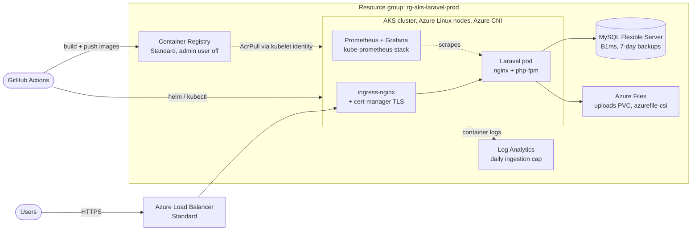

# Laravel on Azure Kubernetes Service (Terraform)

Terraform for the Azure side of a Laravel app running on AKS: the cluster,
a private container registry, MySQL Flexible Server and central logging.
The application, its Kubernetes manifests and the CI/CD pipeline live in
[MSI-health-app-docker](https://github.com/Cloud-n-devops/MSI-health-app-docker).

## Architecture



Terraform in this repo creates the registry, cluster, database and Log
Analytics. Everything inside the cluster is deployed by the pipeline in the
app repo.

## How it works

1. The cluster runs a system node pool and an autoscaling user node pool on
   Azure Linux, with Azure CNI networking and a Standard load balancer.
2. The cluster pulls images from ACR using its kubelet managed identity with
   the `AcrPull` role. The registry's admin account is disabled, so there are
   no registry passwords.
3. The MySQL admin password is generated by Terraform and exposed only as a
   sensitive output.
4. Uploads use a persistent volume claim on the `azurefile-csi` storage class,
   so AKS creates the Azure Files share itself.
5. Container logs go to Log Analytics with a daily ingestion cap, so a noisy
   pod can't run up the bill.
6. The pipeline in the app repo builds the Laravel and nginx images, pushes
   them to ACR tagged with the commit SHA, installs ingress-nginx, cert-manager
   and kube-prometheus-stack with Helm, then deploys the workload.

## Modules

| Module | What it creates |
| --- | --- |
| `compute` | ACR, AKS cluster, autoscaling user node pool, `AcrPull` and Network Contributor role assignments |
| `db` | MySQL Flexible Server, Laravel database, generated admin password |
| `observability` | Log Analytics workspace with daily cap; role for managing cluster extensions |

Monitoring started on Azure Managed Prometheus and Managed Grafana. I moved it
to a self-hosted kube-prometheus-stack inside the cluster to cut cost; the
managed version is still in `modules/observability` as commented code.

## Deploying

```bash
az login
cp credentials.example.tf credentials.tf   # git-ignored
terraform init
terraform plan -out tfplan
terraform apply tfplan

az aks get-credentials --resource-group rg-aks-laravel-prod --name gradestar-aks-cluster
kubectl get nodes
```

Then run the deploy workflow in the app repo. More commands, including pausing
the cluster to save cost, are in [`baseconfig.md`](baseconfig.md).

```bash
az aks stop  --resource-group rg-aks-laravel-prod --name gradestar-aks-cluster   # pause
terraform destroy                                                                  # tear down
```

## Known gaps

- MySQL is reachable through a firewall rule allowing Azure services
  (`0.0.0.0`). Next step: put it on a private subnet like PROJ_001.
- The user node pool's maximum is set to 1 to cap lab cost; raise it for real
  load.
- The pipeline still pushes a `latest` tag alongside the commit SHA; deploying
  by SHA only is safer.
- Terraform state is local.
